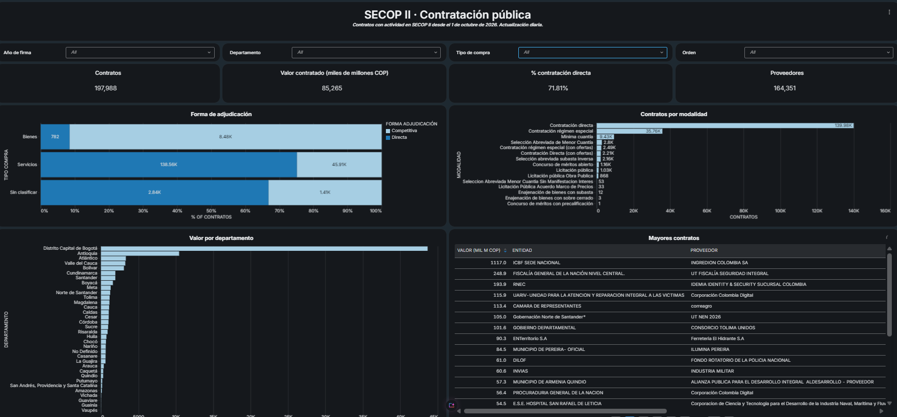
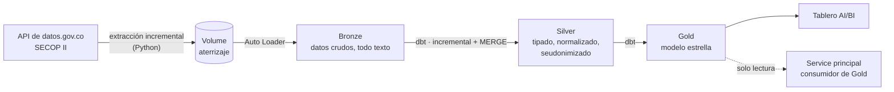
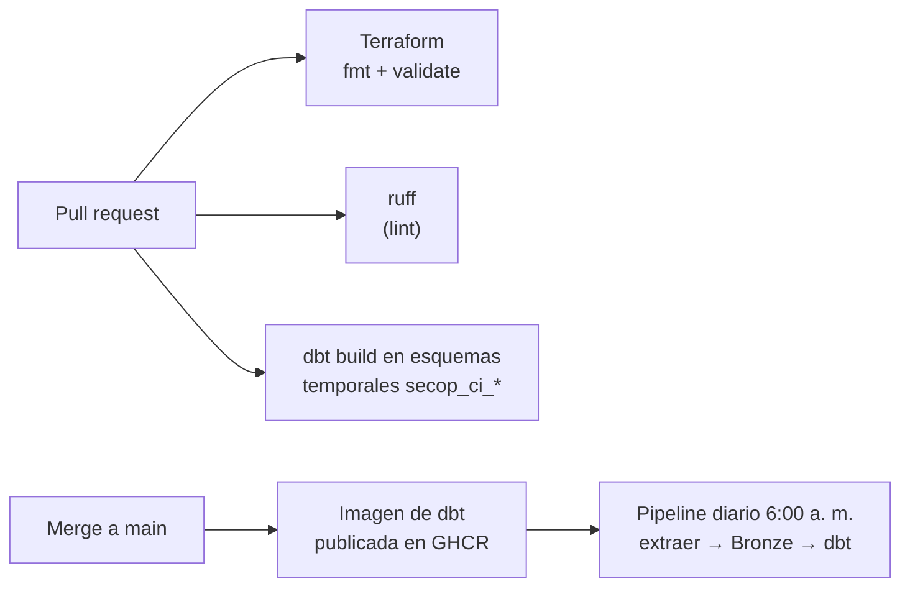
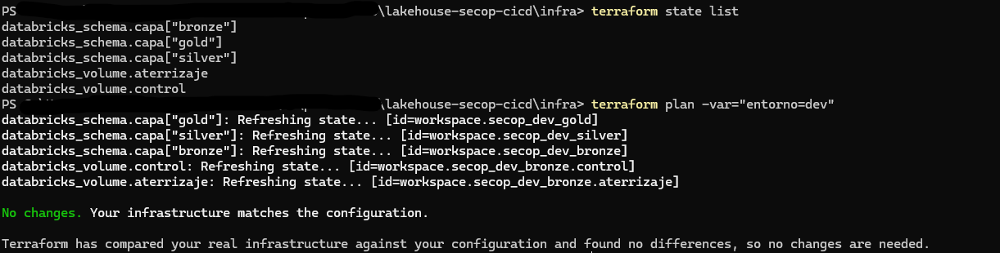
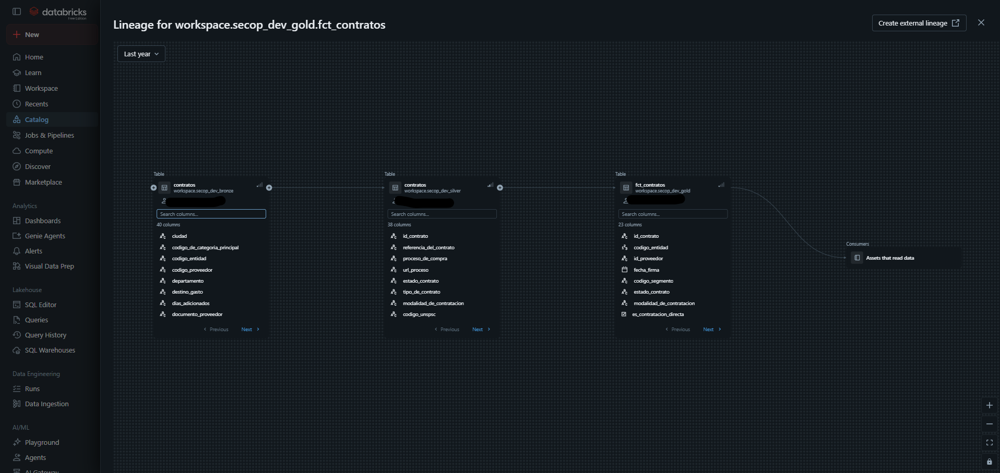
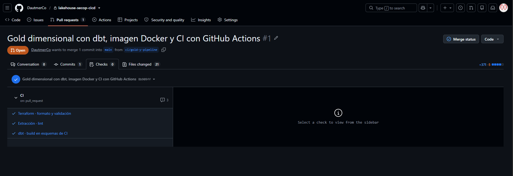
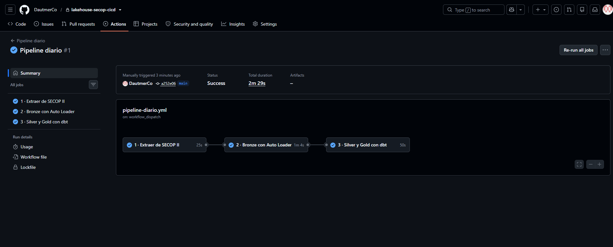

# Lakehouse de contratación pública (SECOP II) con CI/CD

Pipeline de datos sobre la contratación pública de Colombia, construido con prácticas de ingeniería de software. La infraestructura está declarada en Terraform y las transformaciones en dbt, empaquetado en una imagen Docker. Cada cambio pasa por un pull request con pruebas automáticas, y un orquestador en GitHub Actions actualiza los datos todos los días, desde la API pública hasta un tablero.

**Stack:** Databricks (Free Edition) · Unity Catalog · Auto Loader · Delta Lake · dbt (dbt-databricks) · Terraform · Docker · GitHub Actions · GitHub Container Registry · Python · AI/BI Dashboards



## El hallazgo

De los 197.988 contratos con actividad en SECOP II desde octubre de 2026, el **71,8 % se adjudicó por contratación directa**, sin un proceso competitivo. Pero esos contratos suman solo el **31,8 % del valor**. La contratación directa domina en número, no en dinero.

La diferencia está en quién contrata y qué se contrata:

| Grupo | Contratos | % contratación directa |
|---|---|---|
| Servicios | 184.472 | 75,1 % |
| Bienes | 9.261 | 8,4 % |
| Proveedor persona natural | 163.522 | 81,0 % |
| Proveedor persona jurídica (NIT) | 33.307 | 28,7 % |

El 87,9 % de los contratos de servicios son de prestación de servicios, y la mayoría son con personas naturales. Es la forma en que el Estado vincula contratistas individuales, que la ley permite adjudicar de forma directa. Los contratos grandes, de bienes y de obra, pasan sobre todo por procesos competitivos.

> El análisis describe cómo se usa cada modalidad. No implica irregularidades: la contratación directa es una modalidad legal con causales definidas.

## Arquitectura





| Pieza | Qué hace | Código |
|---|---|---|
| Infraestructura | Esquemas por capa, Volumes, el notebook de Bronze, el job, los permisos y el tablero, declarados en Terraform | [infra/](infra/) |
| Extracción | Consulta la API Socrata de datos.gov.co desde la última marca de agua y deja JSON comprimido en el Volume de aterrizaje | [extraer_secop.py](extraccion/extraer_secop.py) |
| Bronze | Auto Loader carga solo los archivos nuevos, con el archivo y la corrida de origen de cada fila | [ingesta_bronze.py](bronze/ingesta_bronze.py) |
| Silver | Un contrato por fila en su última versión, con tipos, textos normalizados y proveedores personas naturales seudonimizados | [silver/contratos.sql](dbt/models/silver/contratos.sql) |
| Gold | Estrella con `fct_contratos` y dimensiones de entidad, proveedor, segmento UNSPSC y fecha | [models/gold/](dbt/models/gold/) |
| Pruebas | 23 pruebas de datos: llaves únicas, integridad referencial, valores permitidos y reglas de negocio | [_silver.yml](dbt/models/silver/_silver.yml), [_gold.yml](dbt/models/gold/_gold.yml), [tests/](dbt/tests/) |
| Contenedor | dbt con el proyecto adentro. El CI y el pipeline diario corren la misma imagen | [Dockerfile](dbt/Dockerfile) |
| CI/CD | Validación en cada pull request y publicación de la imagen al fusionar | [ci.yml](.github/workflows/ci.yml), [imagen.yml](.github/workflows/imagen.yml) |
| Orquestación | Workflow programado que encadena extracción, job de Bronze y dbt | [pipeline-diario.yml](.github/workflows/pipeline-diario.yml) |
| Tablero | Tablero AI/BI guardado como JSON y desplegado con Terraform | [dashboards/](dashboards/) |

### Frente a una arquitectura de referencia en AWS

El diseño parte de una arquitectura típica en AWS y la adapta a servicios sin costo:

| Función | Referencia en AWS | Este proyecto |
|---|---|---|
| Zona de aterrizaje | S3 | Volume de Unity Catalog |
| Registro de imágenes | ECR | GitHub Container Registry |
| Ejecución de dbt | ECS Fargate | Contenedor en un runner de GitHub Actions |
| Orquestación | Airflow (MWAA) | Workflow de GitHub Actions con `needs` y `cron` |
| Secretos | Secrets Manager | Secretos de GitHub Actions |
| Estado de Terraform | S3 + DynamoDB | Local (ver [Limitaciones](#limitaciones)) |

## Decisiones técnicas

**Carga incremental e idempotente de punta a punta.** La extracción guarda una marca de agua: la mayor `ultima_actualizacion` vista, en el Volume `control`. Cada corrida pide solo lo actualizado desde ahí. La marca se mueve al final, así que si algo falla a mitad, la siguiente corrida repite todo sin perder datos. Después:

- **Auto Loader** registra en un checkpoint qué archivos ya cargó.
- **dbt** procesa solo lo que llegó a Bronze desde la última ejecución y lo fusiona con `MERGE` por `id_contrato`.

Como la fecha de actualización no tiene hora, el último día se vuelve a pedir completo. Los duplicados que eso produce se resuelven en Silver, donde queda la versión más reciente de cada contrato.

**Privacidad desde la extracción.** La API trae cuentas bancarias y documentos de identidad de supervisores, ordenadores del gasto y representantes legales. Esas columnas no se extraen. El 82 % de los proveedores son personas naturales identificadas con cédula, así que en Silver:

- Se identifican con el código interno de SECOP.
- El nombre y el documento solo se conservan para personas jurídicas.

**Pruebas que detienen el pipeline.** `dbt build` corre modelos y pruebas en orden del grafo. Si falla una prueba de Silver, Gold no se construye. Las reglas que describen la calidad de la fuente sin invalidarla avisan sin bloquear (`severity: warn`): por ejemplo, 832 contratos registrados con valor 0. Las relaciones de la tabla de hechos con cada dimensión se prueban con `relationships`, la integridad referencial que en una base tradicional darían las llaves foráneas.

**El CI prueba con datos reales sin tocar `dev`.** En cada pull request, la imagen de dbt se construye y ejecuta `dbt build --target ci`. Ese target lee Bronze de dev y escribe en esquemas `secop_ci_*`, que una macro borra al terminar. La macro se niega a correr con otro target, para que nunca borre dev.

**Un mismo artefacto del CI a producción.** El pipeline diario no ejecuta el código del repositorio: descarga la imagen `latest` de GHCR, que es la que se construyó al fusionar el PR que ya pasó el CI.

**Permisos de mínimo privilegio con Terraform.** Un service principal representa a quien consume Gold. Recibe `USE_CATALOG` sobre el catálogo y `USE_SCHEMA` + `SELECT` sobre Gold; Bronze y Silver quedan cerrados. Se usa `databricks_grant` (singular), que agrega permisos sin tocar los que ya existen. `databricks_grants` (plural) reemplazaría todos los permisos del catálogo compartido.

**El tablero también es código.** El tablero se diseña en Databricks y se exporta con [exportar.py](dashboards/exportar.py) a un JSON con sangría, para que cada cambio se vea como un diff en el PR. Terraform lo despliega con `dataset_catalog` y `dataset_schema`, así que el mismo archivo sirve para cualquier entorno. A propósito no tiene una serie por mes de firma: el universo son contratos con *actividad* reciente, y una línea de tiempo mostraría una tendencia falsa.

**Detalles de seguridad en los workflows:**

- El host del workspace se guarda como secreto sin `https://`. GitHub oculta en los logs el valor exacto de cada secreto, y la URL completa lo contiene.
- Del resultado del job de Databricks solo se imprime el estado, porque la respuesta completa incluye el correo de quien lo creó.
- Las versiones de las acciones y de las herramientas están fijadas, para que el pipeline programado no cambie sin un PR.

## Modelo dimensional

| Tabla | Grano | Filas |
|---|---|---|
| `fct_contratos` | Un contrato, en su versión más reciente | 197.988 |
| `dim_entidad` | Una entidad pública contratante | 2.622 |
| `dim_proveedor` | Un proveedor adjudicado | 164.351 |
| `dim_segmento` | Un segmento del clasificador UNSPSC (seed de dbt) | 58 |
| `dim_fecha` | Un día del calendario de firma | 3.652 |

Cifras al 26 de noviembre de 2026. Cambian con cada corrida diaria.

## Capturas

| Infraestructura con Terraform | Linaje en Unity Catalog |
|---|---|
|  |  |
| **Checks de un pull request** | **Pipeline diario** |
|  |  |

El resto (extracción, Volume, job de Bronze, `dbt build`, imagen en GHCR, permisos y el tablero filtrado) está en [docs/capturas/](docs/capturas/).

## Limitaciones

- **El estado de Terraform es local.** Para que GitHub Actions hiciera `plan` en los PR y `apply` al fusionar, el estado tendría que estar en un backend remoto, y la cuenta usada no pudo crear una organización gratuita en HCP Terraform. Por eso el CI valida formato y sintaxis, y el `apply` se ejecuta a mano después del merge. En un equipo real iría en S3 + DynamoDB, Azure Blob o HCP Terraform.
- **Las credenciales del CI son un token personal.** Lo ideal es un service principal con OAuth M2M. Free Edition no permitió emitir tokens para service principals, así que se usa un token personal con vencimiento de 90 días.
- **Un solo entorno con datos.** Todo está parametrizado por entorno (`dev`/`prod`) en Terraform, dbt y el tablero, pero solo se desplegó `dev`.
- **Cobertura de la fuente.** Unos 2 millones de contratos antiguos no tienen fecha de actualización y no entran en una carga incremental. La carga inicial arranca el 1 de octubre de 2026.
- **Sin protección de rama mientras el repo fue privado.** En el plan gratuito, GitHub no exige que el CI pase antes de fusionar en repos privados.

## Cómo ejecutarlo

Requisitos:

- Una cuenta de [Databricks Free Edition](https://www.databricks.com/learn/free-edition).
- La [CLI de Databricks](https://docs.databricks.com/aws/en/dev-tools/cli/install).
- Terraform 1.6 o superior.
- Python 3.12.

1. **Conectar la CLI** a tu workspace:

   ```bash
   databricks auth login --host https://<tu-workspace>.cloud.databricks.com
   ```

2. **Crear la infraestructura:** esquemas, Volumes, notebook, job, permisos y tablero.

   ```bash
   cd infra
   terraform init
   terraform apply -var="entorno=dev"
   ```

3. **Preparar el entorno de Python** y hacer la primera extracción:

   ```bash
   python -m venv .venv && source .venv/bin/activate   # en Windows: .venv\Scripts\Activate.ps1
   pip install -r extraccion/requirements.txt -r dbt/requirements.txt
   python extraccion/extraer_secop.py --perfil DEFAULT
   ```

4. **Cargar Bronze** con el job:

   ```bash
   databricks jobs run-now $(terraform -chdir=infra output -raw id_job)
   ```

5. **Construir Silver y Gold.** dbt lee `DBT_DATABRICKS_HOST`, `DBT_DATABRICKS_HTTP_PATH` y `DBT_DATABRICKS_TOKEN`. En Windows, [conectar.ps1](dbt/conectar.ps1) las toma de tu perfil de la CLI.

   ```bash
   cd dbt
   dbt build
   ```

6. **Automatizar en GitHub.** Crea los secretos `DATABRICKS_HOST` (sin `https://`), `DATABRICKS_HTTP_PATH` y `DATABRICKS_TOKEN`. Al fusionar en `main` se publica la imagen, y el workflow **Pipeline diario** corre todos los días o a mano desde la pestaña Actions.

## Datos

[SECOP II – Contratos Electrónicos](https://www.datos.gov.co/d/jbjy-vk9h), publicado por Colombia Compra Eficiente en el portal de datos abiertos del Estado colombiano (datos.gov.co). Son datos públicos; este repositorio no los incluye, se descargan de la API en cada ejecución. Los nombres de los segmentos UNSPSC del seed son una traducción resumida.

## Estructura

```
├── infra/                 Terraform: esquemas, Volumes, notebook, job, permisos, tablero
├── extraccion/            Extracción incremental desde la API de SECOP II
├── bronze/                Notebook de Auto Loader
├── dbt/                   Proyecto dbt (Silver, Gold, pruebas, seed) y su Dockerfile
├── dashboards/            Tablero AI/BI en JSON y script de exportación
├── .github/workflows/     CI, publicación de la imagen y pipeline diario
└── docs/capturas/         Capturas de cada etapa
```

## Autor

**Dautmer Contreras** · Data Engineer y Power BI Architect · [LinkedIn](https://www.linkedin.com/in/dautmer-contreras)
